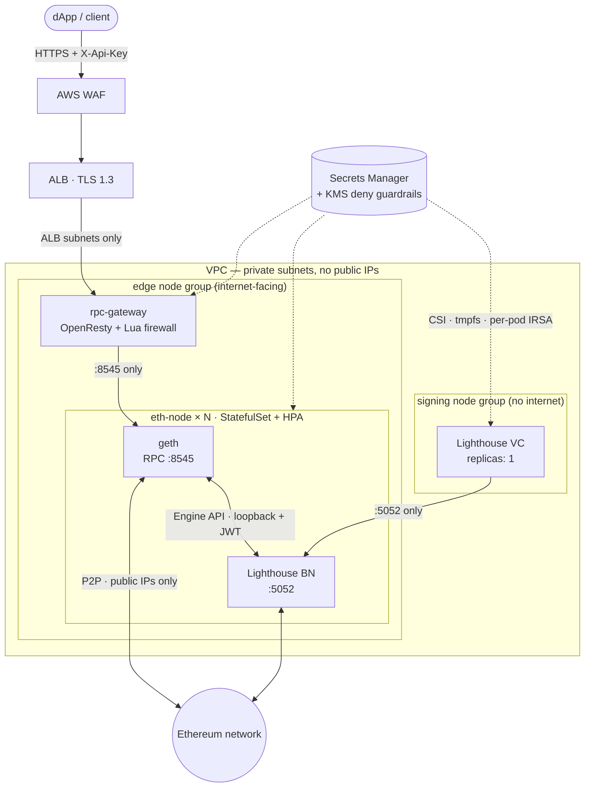

# Hardened Ethereum Node Infrastructure — Terraform + EKS

Production-style infrastructure for running Ethereum **execution + consensus clients** (geth + Lighthouse) and a **validator** on AWS EKS, built security-first:

- **Public JSON-RPC** behind four layers of DDoS and abuse protection.
- **Validator keys** that never touch etcd, Terraform state, or disk in plaintext.
- **Policy-as-code gates** that fail CI on the misconfigurations that actually get node operators drained or slashed.

> Every control below is either **enforced by a policy** or **proven by a test** that runs in CI.
> Where something is a trade-off, [the threat model](docs/threat-model.md) says so.

---

## Highlights

| Area | What's here |
|---|---|
| **RPC DDoS defence in depth** | AWS WAF (IP reputation, known-bad inputs, per-IP rate) → ALB (TLS 1.3, strictest desync mitigation) → OpenResty/Lua **JSON-RPC firewall** (API keys stored as hashes, per-IP + per-tenant rate limits, method allowlist, `eth_getLogs` range caps, batch/body/JSON-depth caps) → geth resource caps → default-deny NetworkPolicies |
| **Validator key custody** | AWS Secrets Manager + KMS CMK → Secrets Store CSI driver → **tmpfs only**. KMS key policy *denies* decrypt to everyone except the validator's IRSA role. Key custodians can **write** keys but **cannot read them back**. Validator containers hold no AWS credentials and have no internet egress. |
| **Slashing protection** | Single-replica StatefulSet (never a Deployment: a rolling-update surge = double signing), doppelganger protection, `Retain` encrypted PVC, and a validator that **fails closed** if its slashing DB is missing (tested) |
| **Trust zones** | Separate node groups: `system` (controllers), `edge` (internet-facing P2P + RPC), `signing` (validator alone). Bottlerocket nodes, IMDSv2 hop-limit 1, Pod Security `restricted` everywhere |
| **Kubernetes hardening** | Private API endpoint, KMS envelope encryption, all control-plane logs, access entries (no `aws-auth`), IRSA scoped to exact `namespace:serviceaccount`, non-root/read-only/no-caps containers, every image pinned by digest |
| **Autoscaling that understands sync** | Readiness = "fully synced", so the HPA ignores syncing replicas' CPU. PVCs are retained on scale-down so scale-up re-attaches already-synced chain data. Cluster Autoscaler with tag-scoped IAM |
| **Policy-as-code** | 44 Rego unit tests; OPA policies on rendered manifests (generic + Ethereum-specific + cross-document) and on `terraform plan` JSON |
| **Supply chain & CI** | Actions pinned by SHA, tool images by digest, OIDC to AWS (no stored keys), `permissions: {}`, gitleaks on full history, Checkov → code scanning, actionlint + zizmor, Renovate with release-age gating |

## Architecture



More detail: [docs/architecture.md](docs/architecture.md) (request path, key path sequence, autoscaling, decision log) · [docs/threat-model.md](docs/threat-model.md) (19 threats → control → file → test) · [docs/runbook.md](docs/runbook.md) (deploy, key loading, migrations, incident response).

## How it's verified

Everything below runs in [CI](.github/workflows/ci.yml) and locally with `make ci` (only Docker needed).

| Check | Result |
|---|---|
| `terraform fmt` / `validate` (both stacks), `tflint` + AWS ruleset | clean |
| Checkov — Terraform (414 checks) and rendered Kubernetes (564 checks) | 0 failed; every suppression justified inline or in `.checkov.yaml` |
| kubeconform strict, incl. CRD schemas | 74/74 resources valid |
| OPA/conftest — per-document + cross-document policies on both overlays | pass |
| Rego unit tests (Kubernetes + Terraform-plan policies) | 44/44 |
| Mutation test — 10 realistic misconfigurations injected into rendered manifests | 10/10 caught |
| [`tests/gateway`](tests/gateway/run.sh) — real `nginx.conf` + Lua in the pinned image, pod hardening applied | 37/37 |
| [`tests/validator`](tests/validator/run.sh) — real EIP-2335 keystores through the real init script and Lighthouse VC | 24/24 |
| shellcheck, actionlint, zizmor, gitleaks | clean |

**Testing against the real clients caught two bugs that review missed:**

1. **Crash-loop on first deploy.** The validator originally mounted its in-memory key volume read-only. Lighthouse v8 writes a `<keystore>.lock` next to each keystore, so it would have failed at start-up. The fix is in the manifest, with a regression test that proves read-only fails.
2. **A persisted key cache.** Lighthouse writes a `validator_key_cache.json` to its data dir. The test showed it can't be redirected to tmpfs (it's written atomically), so it is now asserted to be the *only* key-derived file on the PVC and to be scrypt-encrypted. It's documented as a residual risk instead of being over-claimed.

> **Scope note:** the Terraform has been validated, linted and policy-checked, but not applied in CI; applying needs an AWS account (see the cost note below). The Kubernetes layer has been schema-validated and policy-checked, and its two security-critical components (gateway and validator key path) have been exercised end-to-end in containers.

## Repository layout

```
terraform/
  bootstrap/          remote state: KMS-encrypted, versioned, TLS-only S3 + native locking
  modules/
    network/          VPC, NAT, flow logs, VPC endpoints, locked-down default SG
    kms/              per-purpose CMKs with decrypt-deny guardrails
    eks/              cluster, access entries, OIDC, Bottlerocket node groups, add-ons
    irsa/             IAM role per ServiceAccount (exact ns:sa + audience)
    secrets/          Secrets Manager containers + deny-by-default resource policies
    waf/              WAFv2 web ACL + redacted logging
    cluster-addons/   ALB controller, Secrets Store CSI/ASCP, Cluster Autoscaler, metrics-server, StorageClass
  platform/           root stack + envs/{hoodi,mainnet}.tfvars
k8s/
  base/               eth-node (geth+Lighthouse BN), validator, rpc-gateway
  components/         aws-wiring: Terraform outputs → IRSA, WAF, cert, NetworkPolicy CIDRs
  overlays/           hoodi, mainnet
policies/             OPA/Rego for Kubernetes manifests and Terraform plans (+ tests)
scripts/              key loading, JWT, API keys, Terraform → overlay sync
tests/                gateway + validator functional suites (Docker)
docs/                 architecture, threat model, runbook
```

## Quick start

```bash
make help        # list targets
make lint        # every static check CI runs
make test        # policy unit tests + gateway + validator suites
```

To deploy to AWS, follow [docs/runbook.md § First deployment](docs/runbook.md#1-first-deployment). In short:

```bash
terraform -chdir=terraform/platform init -backend-config=envs/hoodi.s3.tfbackend
terraform -chdir=terraform/platform apply -var-file=envs/hoodi.tfvars
scripts/put-jwt-secret.sh hoodi
scripts/load-validator-keys.sh --env hoodi --keystores ./validator_keys
scripts/manage-api-keys.sh hoodi add my-dapp
scripts/sync-tf-outputs.sh hoodi
kubectl apply -k k8s/overlays/hoodi
```

**Cost note:** a Hoodi testnet deployment is on the order of **$1,000–1,500/month** at on-demand prices (main drivers: edge nodes, VPC interface endpoints, provisioned EBS IOPS). Set `enable_interface_endpoints = false` and `single_nat_gateway = true` to trim it, and `terraform destroy` when the demo is over.

## Stack

Terraform 1.17 · AWS provider 6 · EKS 1.36 · Bottlerocket · geth v1.17.10 · Lighthouse v8.3.3 · OpenResty 1.31 · Secrets Store CSI + AWS provider · AWS Load Balancer Controller · WAFv2 · OPA/conftest · Checkov · tflint · kubeconform · gitleaks · zizmor · GitHub Actions (OIDC)

## Roadmap

- Remote signing with Web3Signer (+ slashing-protection DB), or DVT (Obol/SSV) to remove the single key holder
- Dedicated, non-public beacon node pair for the validator
- GuardDuty EKS Runtime Monitoring / Falco, plus Prometheus alerts (missed attestations, peer count, sync distance)
- Kyverno/Gatekeeper admission policies mirroring the CI Rego, so policy is enforced at deploy time as well
- Cosign verification of client images once upstream signs releases
