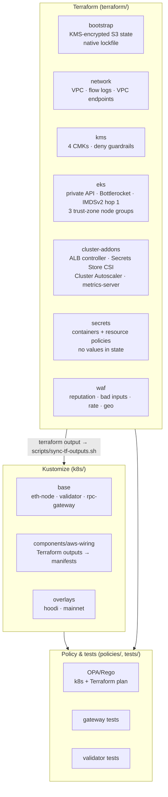
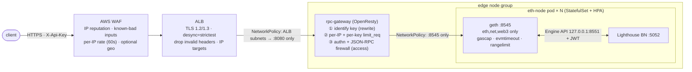
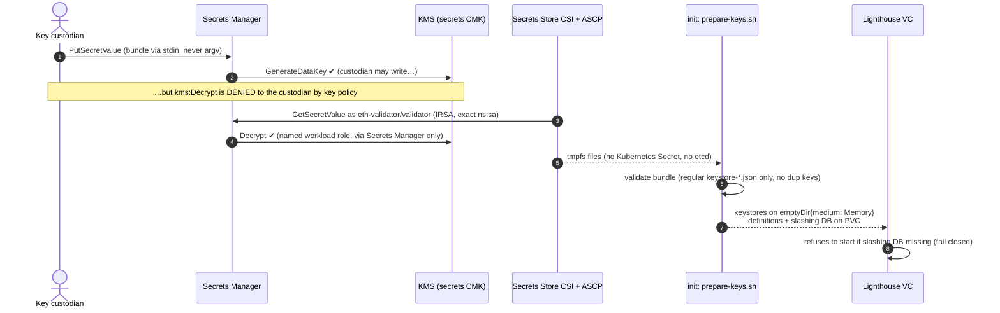

# Architecture

## Layers

## Request path (public JSON-RPC)

Each layer assumes the one before it failed. The WAF can't see API keys, so the gateway enforces per-tenant limits. The gateway can be bypassed only from inside the cluster, which NetworkPolicies prevent. geth's own resource caps bound the cost of any request that gets through.

## Validator key path

The validator containers themselves get **no** AWS credentials (`eks.amazonaws.com/skip-containers`). Only the CSI driver uses the pod identity. Validator egress is limited to the beacon API: no internet, no AWS endpoints, no IMDS.

## Autoscaling design

| Layer | Scales on | Why |
|---|---|---|
| rpc-gateway | CPU, 2–10 replicas, fast scale-up | Stateless; absorbs spikes immediately |
| eth-node | CPU of the **geth container** of **ready** pods, 2–4 (hoodi) / 3–6 (mainnet), slow both ways | A new replica must sync before serving |
| Nodes | Cluster Autoscaler (tag-scoped IAM) | Adds edge nodes for new eth-node pods |
| validator | **Never** | Two signers = slashing |

Two details make CPU-based autoscaling of blockchain nodes workable:

1. **Readiness means "synced".** geth reports ready only when `!eth.syncing && eth.blockNumber > 0`, and Lighthouse only on `/eth/v1/node/health` = `200`. The HPA treats unready pods as 0% CPU when scaling up, so a syncing replica's heavy CPU never triggers further scale-ups.
2. **`persistentVolumeClaimRetentionPolicy.whenScaled: Retain`.** Scaling down keeps the synced volume, so the next scale-up re-attaches it and only catches up the missed blocks instead of doing a full sync.

## Decision log

| Decision | Alternatives | Why |
|---|---|---|
| Secrets Store CSI (tmpfs) with `syncSecret` off | External Secrets Operator → K8s Secret | Keys never enter etcd; each pod fetches with its *own* IRSA role instead of one cluster-wide operator identity |
| AWS Secrets Manager + KMS | HashiCorp Vault | No extra stateful system to secure and operate; KMS key policies give a hard deny guardrail; CloudTrail on every decrypt |
| EL + CL in one pod | Separate StatefulSets | Engine API never leaves loopback; the pair scales as one unit |
| Validator as single-replica StatefulSet on a dedicated node group | Deployment; shared nodes | Deployment surge = double signing; shared kernel with P2P clients = escape risk |
| OpenResty + Lua gateway | eRPC / dshackle / Envoy | Small, auditable firewall (~280 lines of Lua) with full control of phase ordering; tested end-to-end in CI |
| Bottlerocket | AL2023 | Immutable, dm-verity root, SELinux enforcing, minimal userland |
| VPC CNI network policy agent | Calico / Cilium | Native to EKS, no extra CNI; standard `NetworkPolicy` semantics are enough here |
| Kustomize component for AWS wiring | Helm chart; hand-edited ARNs | Plain YAML that policies can read; Terraform outputs flow in without copy-paste |
| Access entries, `bootstrap_cluster_creator_admin_permissions = false` | `aws-auth` ConfigMap | Auditable, API-managed cluster access; the Terraform principal is added explicitly |
| No CPU limits (memory limits required) | CPU limits everywhere | CFS throttling delays block processing and attestations |
